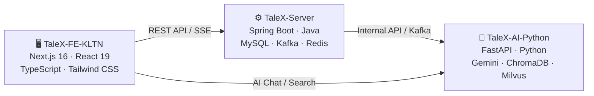

# 🎬 TaleX — Nền Tảng Video Truyện Tranh & Hoạt Hình Ngắn

> **TaleX** là nền tảng chuyên biệt để chia sẻ video ngắn và trung bình, tập trung vào cộng đồng sáng tạo nội dung kể chuyện bằng hình ảnh như **Animated Webtoon** và **Visual Novel**.  
> Hệ thống cung cấp không gian cho các nhà sáng tạo tiếp cận khán giả và tích hợp công cụ quản lý bản quyền nghiêm ngặt.

---

## 🎯 Mục Tiêu Dự Án

- **Đối tượng**: Họa sĩ truyện tranh, nhóm lồng tiếng và khán giả yêu thích Webtoon/Anime.
- **Vấn đề giải quyết**: Phân tâm người xem trên các mạng xã hội đại trà; hỗ trợ nghệ sĩ tối ưu hóa doanh thu.
- **Tính năng nổi bật**:
  - 🎞️ Trình phát video tối ưu theo chương/hồi
  - 🔐 Hệ thống **Content ID** chống re-up và bảo vệ bản quyền
  - 💰 Mô hình kinh tế vi mô: **Fast Pass**, **Donate**, **Coin**
  - 🤖 AI Chatbot gợi ý nội dung theo ngữ nghĩa (RAG + Gemini)
  - 🛡️ Kiểm duyệt nội dung tự động bằng AI

---

## 🏗️ Kiến Trúc Hệ Thống

Dự án được tổ chức theo mô hình **monorepo 3 service** độc lập:

```
TaleX/
├── TaleX-FE-KLTN/      ← Frontend (Next.js 16 + React 19)
├── TaleX-Server/       ← Backend (Spring Boot — Java)
└── TaleX-AI-Python/    ← AI Service (FastAPI — Python)
```



---

## 📁 Cấu Trúc Thư Mục

### 🖥️ `TaleX-FE-KLTN` — Frontend

Ứng dụng web Next.js 16 với kiến trúc **Feature-Sliced Design (FSD)**.

```
TaleX-FE-KLTN/
├── src/
│   ├── app/                    ← Next.js App Router (pages & layouts)
│   │   ├── (auth)/             ← Nhóm route xác thực
│   │   ├── watch/              ← Trang xem video
│   │   ├── creator/            ← Trang creator dashboard
│   │   ├── admin/              ← Trang quản trị
│   │   └── ...                 ← Các route khác
│   │
│   ├── features/               ← Tính năng nghiệp vụ (Feature Slices)
│   │   ├── auth/               ← Đăng nhập, đăng ký, OAuth
│   │   ├── home/               ← Trang chủ, feed video
│   │   ├── playback/           ← Trình phát video HLS
│   │   ├── search/             ← Tìm kiếm video (AI semantic search)
│   │   ├── comics/             ← Truyện tranh / series
│   │   ├── series/             ← Quản lý series chương hồi
│   │   ├── creator-dashboard/  ← Dashboard nhà sáng tạo
│   │   ├── premium/            ← Tính năng premium / Fast Pass
│   │   ├── payment/            ← Thanh toán
│   │   ├── checkout/           ← Luồng checkout
│   │   ├── coin/               ← Hệ thống coin nội bộ
│   │   ├── comments/           ← Bình luận
│   │   ├── notifications/      ← Thông báo real-time
│   │   ├── recommendations/    ← Gợi ý nội dung
│   │   ├── moderation-reports/ ← Báo cáo vi phạm
│   │   ├── admin/              ← Quản trị viên
│   │   ├── advertiser-dashboard/ ← Dashboard nhà quảng cáo
│   │   ├── ads/                ← Quảng cáo
│   │   ├── mission/            ← Hệ thống nhiệm vụ / điểm thưởng
│   │   ├── onboarding/         ← Luồng onboarding người dùng mới
│   │   └── ...
│   │
│   ├── shared/                 ← Code dùng chung toàn app
│   │   ├── api/                ← Axios client, API helpers
│   │   ├── hooks/              ← Custom React hooks
│   │   ├── stores/             ← Zustand state management
│   │   ├── ui/                 ← Shared UI components (shadcn/ui)
│   │   └── utils/              ← Utility functions
│   │
│   ├── core/                   ← Cấu hình nền tảng
│   │   ├── config/             ← App config, constants
│   │   └── providers/          ← React Context providers
│   │
│   └── mocks/                  ← MSW mock handlers (dev/test)
│
├── public/                     ← Static assets
├── .ai-docs/                   ← Tài liệu ngữ cảnh cho AI assistant
├── next.config.ts              ← Next.js config
├── tailwind.config.ts          ← Tailwind CSS config
├── components.json             ← shadcn/ui config
└── vitest.config.ts            ← Cấu hình unit test
```

**Tech Stack Frontend:**

| Thành phần | Công nghệ |
|---|---|
| Framework | Next.js 16 (App Router) |
| UI Library | React 19 |
| Language | TypeScript |
| Styling | Tailwind CSS + shadcn/ui + Radix UI |
| State | Zustand + TanStack Query |
| Video | HLS.js |
| Animation | Framer Motion |
| Testing | Vitest + MSW |

---

### ⚙️ `TaleX-Server` — Backend (Spring Boot)

REST API server viết bằng **Java Spring Boot** theo kiến trúc 3 tầng.

```
TaleX-Server/
├── src/main/java/com/talex/server/
│   ├── TalexServerApplication.java  ← Điểm khởi chạy Spring Boot
│   ├── configs/                     ← Cấu hình: Security, Database, Kafka, CORS
│   ├── controllers/                 ← Presentation Layer: nhận HTTP request
│   ├── dtos/                        ← Data Transfer Objects (request/response)
│   ├── entities/                    ← JPA Entities (database models)
│   ├── enums/                       ← Hằng số định danh
│   ├── exceptions/                  ← Xử lý lỗi tập trung
│   ├── mappers/                     ← Chuyển đổi Entity ↔ DTO
│   ├── repositories/                ← Data Access Layer: JPA repositories
│   ├── services/                    ← Business Logic Layer
│   ├── schedulers/                  ← Scheduled tasks (cron jobs)
│   ├── workers/                     ← Kafka consumers / async workers
│   ├── policies/                    ← Authorization policies
│   ├── specifications/              ← JPA Specifications (dynamic queries)
│   ├── annotations/                 ← Custom annotations
│   ├── records/                     ← Java Records (immutable DTOs)
│   ├── resolver/                    ← Argument resolvers
│   └── utils/                       ← Helper classes dùng chung
│
├── src/main/resources/
│   ├── application.yaml             ← Cấu hình chính
│   ├── application-local.yaml       ← Cấu hình môi trường local
│   └── templates/                   ← Email/PDF templates
│
├── docs/                            ← Tài liệu kỹ thuật
├── certs/                           ← SSL certificates
├── kafka-streams-state/             ← Kafka Streams local state store
└── pom.xml                          ← Maven dependencies
```

**Tech Stack Backend:**

| Thành phần | Công nghệ |
|---|---|
| Framework | Spring Boot (Java) |
| Database | MySQL + Spring Data JPA |
| Message Queue | Apache Kafka + Kafka Streams |
| Cache | Redis |
| Auth | Spring Security + JWT + OAuth2 |
| Storage | AWS S3 |
| Build | Maven |
| License | Apache License 2.0 |

---

### 🤖 `TaleX-AI-Python` — AI & Content ID Service

Python microservice cung cấp **AI features** và **bảo vệ bản quyền** bằng video fingerprint.

```
TaleX-AI-Python/
├── app/
│   ├── main.py                 ← Điểm khởi chạy FastAPI
│   ├── core/                   ← Config, logging, rate limiter, error handler
│   ├── routers/                ← HTTP endpoints (Tầng 1)
│   ├── services/               ← Business logic (Tầng 2)
│   ├── schemas/                ← Pydantic DTOs (request/response)
│   ├── rag/                    ← ChromaDB + Embedding (semantic search)
│   ├── llm/                    ← Google Gemini (chatbot, tagging, moderation)
│   ├── fingerprint/            ← FFmpeg + imagehash + Milvus (Content ID)
│   ├── kafka/                  ← Kafka consumer/producer
│   ├── db/                     ← Database clients
│   └── aws/                    ← AWS Rekognition client
│
├── data/
│   └── seed_videos.json        ← Video mẫu cho demo/dev
├── scripts/                    ← Scripts tiện ích
├── tests/                      ← Unit/integration tests
├── chroma_data/                ← ChromaDB local storage
├── docker-compose.yml          ← Python app + Milvus containers
├── Dockerfile                  ← Container build
├── requirements.txt            ← Python dependencies
├── .env.example                ← Mẫu biến môi trường
└── SETUP.md                    ← Hướng dẫn cài đặt & chạy
```

**Tech Stack AI Service:**

| Thành phần | Công nghệ | Vai trò |
|---|---|---|
| Framework | FastAPI + Uvicorn | REST API server |
| LLM | Google Gemini 2.5 Flash | Chatbot, auto-tagging, kiểm duyệt |
| Embedding | sentence-transformers (MiniLM-L6-v2) | Text → vector |
| Text Vector DB | ChromaDB | Semantic search video |
| Video Fingerprint | FFmpeg + pHash | Trích xuất frames + tạo hash |
| Video Vector DB | Milvus | So sánh fingerprint, detect re-up |
| Validation | Pydantic v2 | DTO & schema validation |
| Rate Limiting | SlowAPI | Giới hạn request theo IP |
| Logging | Loguru | Log file + console |

**API Endpoints chính:**

| Method | Endpoint | Mô tả |
|---|---|---|
| `POST` | `/api/v1/search` | Tìm video theo ngữ nghĩa |
| `POST` | `/api/v1/chat` | Chatbot RAG (Gemini + ChromaDB) |
| `POST` | `/api/v1/sync` | Đồng bộ metadata từ Spring Boot |
| `POST` | `/api/v1/content/analyze` | Auto-tagging video |
| `POST` | `/api/v1/moderation/check` | Kiểm duyệt nội dung |
| `POST` | `/api/v1/fingerprint/process` | Fingerprint + kiểm tra bản quyền |
| `GET` | `/health` | Health check |

---

## 🚀 Bắt Đầu Nhanh

### Yêu cầu

- **Node.js** ≥ 20
- **Java** 21
- **Python** 3.11+
- **Docker** & Docker Compose
- **MySQL**, **Redis**, **Kafka** (hoặc chạy qua Docker)

### 1. Frontend

```bash
cd TaleX-FE-KLTN
npm install
cp .env.example .env.local   # Điền các biến môi trường
npm run dev                  # http://localhost:3000
```

### 2. Backend (Spring Boot)

```bash
cd TaleX-Server
cp .env.example .env         # Điền DB, Kafka, Redis, JWT, ...
./mvnw spring-boot:run       # http://localhost:8080
```

### 3. AI Service (Python)

```bash
cd TaleX-AI-Python
cp .env.example .env         # Điền GEMINI_API_KEY, ...
docker-compose up -d         # Khởi Milvus container
pip install -r requirements.txt
uvicorn app.main:app --reload  # http://localhost:8000
```

> Xem chi tiết tại [SETUP.md](TaleX-AI-Python/SETUP.md)

---

## 👥 Nhóm Phát Triển

Dự án **TaleX** được phát triển bởi nhóm sinh viên trong khuôn khổ **Khóa Luận Tốt Nghiệp (KLTN)**.

---

## ⚖️ Bản Quyền

Dự án được bảo hộ bởi **Apache License 2.0**.  
Mọi hành vi sao chép trái phép nội dung trên nền tảng sẽ bị xử lý bởi hệ thống Watermark động và Content ID.

Copyright © 2026 Talex Team. All rights reserved.
